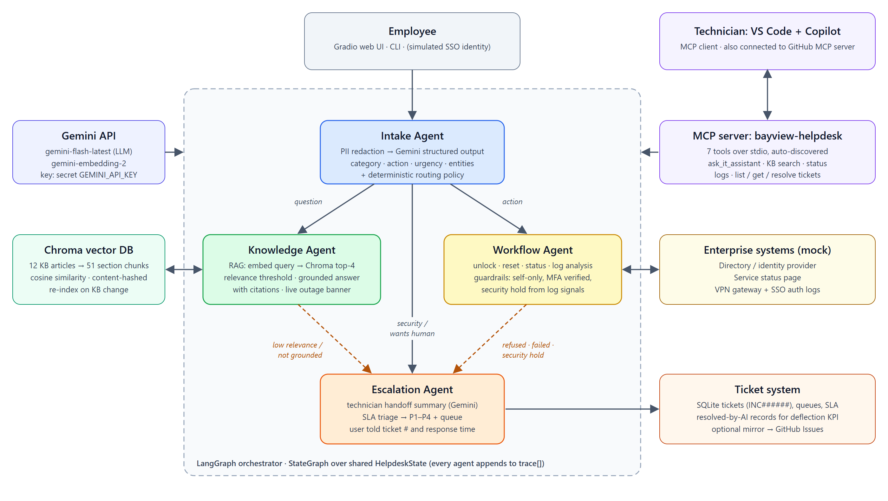

# 🛟 Bayview IT Assistant: Multi-Agent AI for IT Support

**BUS 118s-01 Capstone** · LangGraph · Google Gemini · Chroma RAG · Model Context Protocol (MCP) · Gradio

An AI "front door" for IT support. Four cooperating agents resolve employee requests:

| Agent | Role |
|---|---|
| 🧭 **Intake** | Redacts PII, classifies the request and extracts entities with Gemini structured output, then a deterministic policy routes it |
| 📚 **Knowledge** | RAG over the IT knowledge base: Gemini embeddings → Chroma → grounded answer with citations, or escalate if it can't ground one |
| ⚙️ **Workflow** | Automations: unlock account, password reset, service status, log analysis, with guardrails enforced inside each tool |
| 🙋 **Escalation** | Writes a technician handoff, triages by SLA (P1-P4), opens a ticket (optionally a GitHub Issue) |



## Deliverables

| Deliverable | Where |
|---|---|
| Documented code | `helpdesk/` (every module has a docstring explaining its role), `app.py`, `mcp_server.py` |
| Screenshots of successful runs | [`docs/screenshots/`](docs/screenshots): CLI demo, tests, evaluation, MCP client, Gradio UI |
| Design diagram, implementation, testing and scaling document | [`docs/DESIGN.md`](docs/DESIGN.md) · PDF: [`docs/Design_Implementation_Testing_Scaling.pdf`](docs/Design_Implementation_Testing_Scaling.pdf) |
| Google Colab notebooks | [`notebooks/01_IT_Assistant_Demo.ipynb`](notebooks/01_IT_Assistant_Demo.ipynb) · [`notebooks/02_Evaluation.ipynb`](notebooks/02_Evaluation.ipynb) |
| Evaluation results | [`eval/results/`](eval/results) (`report.md`, `results.csv`, `charts.png`) |

## Quick start: Google Colab (recommended)

1. Open `notebooks/01_IT_Assistant_Demo.ipynb` in Colab (File → Upload notebook, or open from GitHub).
2. Add your key as a **Colab secret named `GEMINI_API_KEY`** (🔑 sidebar → enable notebook access).
3. Runtime → Run all. The last cell prints a public Gradio link.

`02_Evaluation.ipynb` runs the 37-scenario test suite with an LLM judge and compares Gemini against the rule-based baseline.

## Quick start: local

```bash
python -m venv .venv
```
```bash
.venv\Scripts\pip install -r requirements.txt
```

Set the key (or copy `.env.example` to `.env`):

```bash
setx GEMINI_API_KEY "your-key"
```

Then:

| Command | What it does |
|---|---|
| `python -m helpdesk.cli` | Scripted demo of every agent path |
| `python -m helpdesk.cli --user asmith "I'm locked out"` | One message as a given user |
| `python app.py` | Web UI at http://127.0.0.1:7860 |
| `python mcp_server.py` | MCP server (stdio), used by `.vscode/mcp.json` |
| `python scripts/mcp_client_demo.py` | Generic MCP client discovers and calls the tools |
| `python -m pytest -v tests` | 15 unit + integration tests (offline) |
| `python eval/run_eval.py --judge` | Scenario evaluation with LLM-judge satisfaction |
| `python scripts/build_notebooks.py` | Regenerate the Colab notebooks from source |
| `python scripts/capture_screenshots.py` | Re-capture all screenshots (uses installed Edge) |
| `python scripts/render_docs.py` | Re-render the architecture PNG and design PDF |

Without a key the system runs in **offline mode** (keyword classifier, hashed embeddings, extractive answers). It is clearly labelled everywhere and is used for tests and as a baseline.

## The API key

The code reads a secret named **`GEMINI_API_KEY`**, checked in order: Colab secrets → environment variable → `.env`. It is never printed or logged. Default models: `gemini-flash-latest` (chat) and `gemini-embedding-2` with fallback `gemini-embedding-001`. Both can be overridden with `GEMINI_MODEL` / `GEMINI_EMBEDDING_MODEL`.

## MCP in VS Code

`.vscode/mcp.json` registers two servers: the **GitHub MCP server** and **bayview-helpdesk** (this project). In Copilot agent mode, try:

> *List open P1 tickets, analyse the auth log for ceo, and open a GitHub issue summarising the security concern.*

## Demo users (mock directory)

| User | Notes |
|---|---|
| `jdoe` | Normal user |
| `asmith` | Currently **locked**; logs show lockouts come from an old password on a phone |
| `pchen`, `tkim` | Normal users |
| `rpatel` | **No MFA enrolled**, so automations are refused and escalated |
| `mrivera` | VIP (priority bump) |
| `ceo` | VIP with **suspicious sign-ins** (impossible travel), so account changes go on security hold |

## Project layout

```
helpdesk/   config · privacy · schemas · llm · offline · knowledge_base · store · tools · agents · graph · cli
data/       kb/ (12 articles) · directory.json · services.json · logs/
eval/       scenarios.json · run_eval.py · results/
tests/      test_helpdesk.py
notebooks/  Colab notebooks (generated)
scripts/    mcp_client_demo · build_notebooks · capture_screenshots · render_docs
docs/       DESIGN.md · PDF · architecture.svg/png · diagrams/ · screenshots/
```
