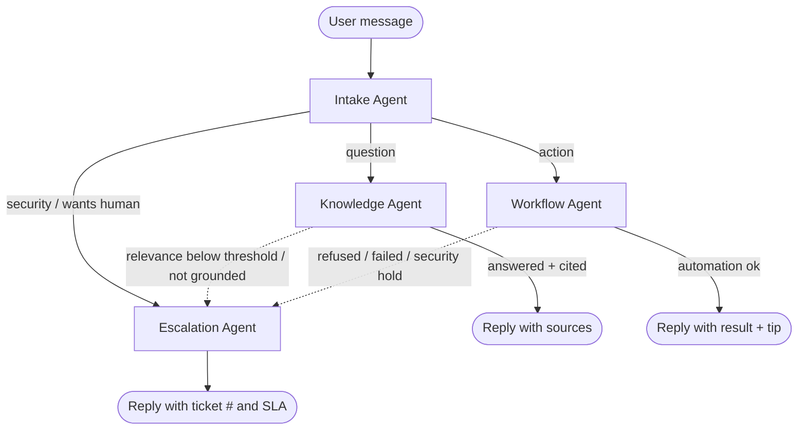
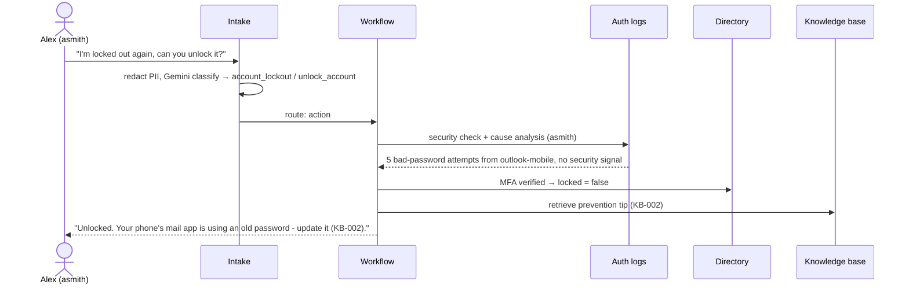
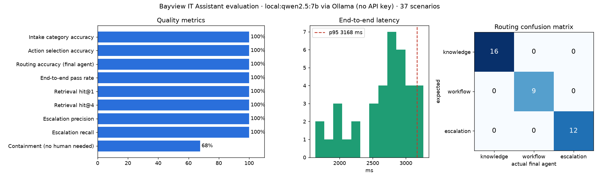

# Bayview IT Assistant: Design, Implementation, Testing & Scaling

**Multi-agent AI system for IT support** · BUS 118s-01 Capstone · LangGraph + Google Gemini + Chroma + MCP

---

## 1. Executive summary

Bayview Logistics (a fictional 1,200-employee company) runs a Service Desk where most tickets are repetitive: passwords, lockouts, VPN, "is X down?", how-to questions. The **Bayview IT Assistant** is a prototype of an AI "front door" for IT. Four specialised agents work together:

| Agent | Responsibility | Key technique |
|---|---|---|
| **Intake** | Understand and classify the request; strip sensitive data | Gemini structured output (Pydantic schema) + deterministic routing policy |
| **Knowledge** | Answer how-to questions from the IT knowledge base | RAG: Gemini embeddings → Chroma vector DB → grounded answer with citations |
| **Workflow** | Do things: unlock accounts, reset passwords, check service status, analyse logs | Tool execution with built-in guardrails |
| **Escalation** | Hand unresolved or risky cases to the right human team | Handoff summary + SLA-based triage into a ticket queue (optional GitHub Issue) |

The same capabilities are exposed through an **MCP server**, so a technician using VS Code + Copilot (alongside the GitHub MCP server) can search the KB, analyse logs and work the ticket queue without any custom integration code.

The system runs on **Google Gemini** or **fully locally with open-source models** (Qwen 2.5 7B + nomic-embed-text via Ollama): no API key, and no employee data leaves the machine. A rule-based offline mode serves as the test baseline.

We position the project as a **lightweight, transparent alternative** to enterprise platforms such as Glean and ServiceNow + Moveworks (§9).

---

## 2. Problem definition & use case

### 2.1 Pain points (current state)

| Stakeholder | Pain point |
|---|---|
| Employees | Wait hours for simple fixes (locked account = blocked from working); KB articles are hard to find; have to repeat themselves when tickets are reassigned |
| Service Desk (L1) | Industry benchmarks commonly cite password and lockout issues as a large share of L1 volume; agents spend time on copy-paste answers instead of complex work |
| Security Ops | Phishing and compromised-account reports arrive late or are misrouted to the general queue |
| IT leadership | No data on which issues could be self-served; SLA breaches on high-priority tickets buried under low-priority volume |

### 2.2 In-scope scenarios

1. **How-to questions**: MFA setup, VPN errors, Outlook, printers, software installs, access requests (Knowledge Agent).
2. **Account automation**: self-service unlock and password reset with MFA verification (Workflow Agent).
3. **Status and diagnostics**: "Is VPN down?", "Why do I keep getting locked out?" via service status and log analysis (Workflow Agent).
4. **Ticket triage and escalation**: security incidents, requests on someone else's account, out-of-scope questions, failed automations (Escalation Agent).

### 2.3 Success metrics

| Metric | Definition | Target (prototype) |
|---|---|---|
| Routing accuracy | Correct agent produced the final answer | ≥ 90% |
| Escalation recall | Cases that need a human reach a human | **100%** (safety-critical) |
| Escalation precision | Escalations that were actually needed | ≥ 85% |
| Containment / deflection | Requests resolved without a human | ≥ 55% of scenario mix |
| Retrieval hit@4 | Correct KB article in top-4 chunks | ≥ 90% |
| Latency p95 | End-to-end response time | < 10 s (Gemini) |
| Satisfaction | LLM-judge (1-5) now; thumbs-up/down CSAT in pilot | ≥ 4.0 / 5 |

---

## 3. Product ownership

### 3.1 Personas

- **Alex (Account Executive, non-technical)**: locked out before a client call; wants it fixed *now* and in plain language.
- **Priya (Data Engineer)**: comfortable with tech; wants quick answers and status info, hates ticket forms.
- **Sam (L1 technician)**: wants fewer repetitive tickets and complete context when something is escalated.
- **Dana (Security analyst)**: needs every suspicious report immediately, with evidence, and never "auto-resolved".

### 3.2 Prioritised backlog (MoSCoW)

| # | User story | Priority | Delivered |
|---|---|---|---|
| 1 | As an employee, I can ask a question in plain English and get a cited answer from the KB | Must | ✅ |
| 2 | As an employee, I can unlock my own account / reset my password after MFA verification | Must | ✅ |
| 3 | As a security analyst, every security-related message reaches Security Ops as P1, never auto-handled | Must | ✅ |
| 4 | As a technician, escalated tickets include a summary, steps tried and the transcript | Must | ✅ |
| 5 | As an employee, I'm told when there's a known outage instead of troubleshooting blindly | Should | ✅ |
| 6 | As an employee, I learn *why* I keep getting locked out (log analysis) | Should | ✅ |
| 7 | As a technician, I can work the queue from VS Code via MCP | Should | ✅ |
| 8 | As IT leadership, I can see deflection and accuracy metrics | Should | ✅ (eval report) |
| 9 | Escalations are mirrored to GitHub Issues / Jira | Could | ✅ GitHub (optional) |
| 10 | Voice channel, Teams/Slack bot | Won't (this release) | — |
| 11 | Real Entra ID / Okta writes | Won't (prototype uses a mock directory) | — |

### 3.3 Key product decisions

- **Safety over containment.** We accept a lower deflection rate in exchange for 100% escalation recall: security incidents, actions on other people's accounts and unknown questions always go to a person.
- **The LLM classifies, policy decides.** The model extracts *what* the user wants; a small, testable Python policy decides *where* it goes (`route_from_intake`). Auditors can read the routing rules in ten lines. Policy also double-checks risky flags: "wants a human" only counts if the message actually asks for a person, because the 7B local model sometimes inferred it from "please unlock it".
- **Tools enforce their own guardrails.** The Workflow Agent cannot reset someone else's password even if the LLM is tricked into asking; the tool itself refuses.
- **Show your work.** The UI shows which agents ran, retrieval scores and sources, which builds trust and makes the demo self-explanatory.

---

## 4. Architecture


### 4.1 Orchestration

The system is a LangGraph `StateGraph` over a shared typed state (`HelpdeskState`): requester, redacted message, intake result, retrieved chunks, tool result, answer, sources, ticket, and an append-only `trace`. Each agent is a node that returns a partial state update.

<!-- mermaid:graph -->


### 4.2 Agent roles and collaboration

| Agent | Inputs | Outputs | Collaborates with |
|---|---|---|---|
| Intake | Raw message, requester, last 6 turns | `IntakeResult`: category (12), request type, action, target user, service, urgency, wants_human, summary, confidence | Routes to the other three |
| Knowledge | Redacted message, service | Answer, cited chunk ids, `grounded` flag | Calls the *status tool* to add a live-outage banner; hands off to Escalation when retrieval is weak or the model says the context doesn't answer |
| Workflow | Action + entities | `ToolResult` (ok / refused / needs_escalation) + user-friendly explanation | Uses the KB for a prevention tip; uses log analysis as a security check before account changes; hands off to Escalation on refusal |
| Escalation | Everything gathered so far | Ticket (priority, queue), handoff summary, user message with SLA | Reads Knowledge/Workflow results so the technician sees "steps tried" |

### 4.3 Sequence: lockout with log analysis

<!-- mermaid:sequence -->


---

## 5. Implementation details

### 5.1 Technology choices

| Layer | Choice | Why | Alternative considered |
|---|---|---|---|
| Orchestration | **LangGraph 1.x** | Explicit graph = auditable control flow, typed shared state, conditional edges; recommended by the course | CrewAI (less control over routing), plain function calls (no graph visualisation / checkpointing) |
| LLM | **Gemini (`gemini-flash-latest`)** via `google-genai` | Fast and cheap; native JSON-schema structured output; alias tracks the current stable Flash (the 2.5 models were retired on 2026-10-16) | Larger "Pro" model: better reasoning but slower and more expensive for a classification-heavy workload |
| Embeddings | **`gemini-embedding-2`** (fallback `gemini-embedding-001`), 768-dim, `RETRIEVAL_QUERY` / `RETRIEVAL_DOCUMENT` task types | Same vendor and key; asymmetric task types improve retrieval | Open-source sentence-transformers (no API cost, but adds PyTorch as a heavy dependency) |
| Local models (no key) | **Ollama** serving **`qwen2.5:7b`** (chat) and **`nomic-embed-text`** (embeddings, with `search_query:` / `search_document:` prefixes) | Free, private (data never leaves the device), no rate limits; Ollama constrains decoding to our Pydantic JSON schemas, so agent contracts are unchanged; plain HTTP, no extra Python dependency | Hugging Face Transformers in-process (more code, slower to load), larger local models (don't fit a 10 GB GPU) |
| Vector DB | **Chroma** (embedded, persistent) | Zero-ops, runs in Colab and locally; cosine HNSW | Pinecone / Weaviate for production (§7) |
| Tickets | SQLite (+ optional GitHub Issues mirror) | Real queryable store with zero setup | ServiceNow / Jira via MCP in production |
| UI | **Gradio 6** | Chat + side panels in ~100 lines; public share link from Colab | Streamlit (similar), React (more polish, much more time) |
| Integration | **MCP server** (`mcp` 2.x `MCPServer`, stdio) | Standard tool discovery for any MCP client (VS Code, Claude) | Hand-written REST API + per-client glue |

### 5.2 RAG pipeline

1. **Corpus**: 12 Markdown KB articles with front matter (id, title, category, updated date).
2. **Chunking**: split by `##` section with the article title prepended, so each chunk is a self-contained answer unit: **51 chunks**. Section-level chunks give precise citations ("KB-004 › Error messages").
3. **Embedding & indexing**: chunks embedded with `RETRIEVAL_DOCUMENT`, stored in Chroma (cosine). The collection stores a content hash, so it **re-indexes automatically when the KB changes**, and uses one collection per embedding model so vector spaces never mix.
4. **Retrieval**: the query is embedded with `RETRIEVAL_QUERY`, top-4 chunks are returned with similarity scores.
5. **Relevance gate**: if the best score is below a threshold, the Knowledge Agent **escalates instead of guessing**. Each embedding model has its own scale, so each provider has its own threshold: 0.64 for nomic-embed-text, calibrated on the scenarios (relevant questions ≥ 0.676, off-topic ≤ 0.594); 0.55 for Gemini; 0.15 for the offline baseline. All are configurable.
6. **Grounded generation**: Gemini answers *only* from the numbered chunks, returns `cited_ids` and a `grounded` flag. `grounded=false` triggers escalation. Citations are shown under every answer.

**Hallucination controls:** relevance gate · context-only system prompt · structured `grounded` self-check · temperature 0 for classification and RAG · citations the user can verify · no URLs or policies outside the KB.

### 5.3 Workflow automation and guardrails

| Tool | What it does | Guardrails |
|---|---|---|
| `unlock_account` | Clears a lockout and explains the cause from auth logs | Requester's own account only · MFA enrolled · **security hold** if logs show impossible travel / denied MFA |
| `reset_password` | Sends a one-time reset link (15 min) to the registered work email, unlocks if needed | Same as above; the assistant never sees or sets a password |
| `check_service_status` | Live status for VPN, email, SSO, Wi-Fi, printing, HR portal, Company Portal | If the user reports a high-urgency outage the status page doesn't know about, escalate to Network Ops |
| `analyze_logs` | Parses VPN/auth logs: error reasons, per-user patterns, gateway health, security signals | Scoped to the requester; path-traversal safe; security signal → escalation |
| `create_ticket` | SLA triage (category × urgency × VIP → P1-P4 + queue per KB-012), optional GitHub Issue | Security → always P1 Security Ops |

Every self-resolved request is also logged as a `resolved` ticket (`resolved_by = Knowledge Agent / Workflow Agent`) so leadership can measure deflection.

### 5.4 Escalation

The Escalation Agent asks Gemini for a `HandoffSummary` (title, 2-3 sentence summary, steps tried), creates the ticket, and tells the user the ticket number, queue and first-response SLA (15 min for P1 … 1 business day for P4). The redacted transcript is attached so the user never repeats themselves.

### 5.5 MCP integration

`mcp_server.py` exposes 7 tools (`ask_it_assistant`, `search_knowledge_base`, `check_service_status`, `analyze_logs`, `list_tickets`, `get_ticket`, `resolve_ticket`). `.vscode/mcp.json` registers it next to the **GitHub MCP server**, so in VS Code Copilot agent mode a technician can say *"list open P1 tickets, analyse the auth log for ceo, and open a GitHub issue for the VPN gateway problem"*.

| | Traditional REST API | MCP |
|---|---|---|
| Discovery | Read docs / OpenAPI, write a client per consumer | Client calls `list_tools` and gets names, descriptions and JSON schemas at runtime |
| Integration effort | One integration per (tool × client) pair (N × M) | Each tool server works with every MCP client (N + M) |
| LLM readiness | Need to hand-write function/tool definitions for each model | Tool schemas are already in the format agents consume |
| Transport / auth | Custom per API | Standard transports (stdio, streamable HTTP) and an OAuth-based auth spec |

`scripts/mcp_client_demo.py` proves the point: a generic client with no helpdesk knowledge discovers and calls every tool (screenshot `04_mcp_client.png`).

### 5.6 Privacy and safety

- **PII redaction** (`privacy.py`) before any text reaches the LLM, a ticket, or a log: passwords typed into chat, SSNs, card numbers, phone numbers, personal email addresses. Work usernames/emails are kept because agents need them.
- **Secrets**: the Gemini key is read from the secret `GEMINI_API_KEY` (Colab secrets → env var → `.env`) and never printed. `.env` is git-ignored.
- **Least privilege**: tools act only on the requester's identity; there is no "admin" path for the LLM.
- **Prompt-injection resilience**: even if a user persuades the LLM to choose `reset_password` for someone else, the tool refuses and escalates (unit-tested).

### 5.7 UX design

Design principles: *clarity, transparency, zero dead ends.*

- Single chat box with **example prompts** so users know what the assistant can do.
- Answers are **one-line summary + numbered steps** with **sources** underneath.
- **"Under the hood" panel** shows the agent path (Intake → Workflow), per-agent latency, retrieval scores, automation result and ticket, which is useful for trust and for demos.
- **Live ticket queue** shows escalations and self-resolved records appearing in real time.
- Every escalation states **what happens next and when** (ticket #, team, SLA). The user is never left without a next step.
- Identity comes from (simulated) SSO, so users never type usernames or passwords into the bot.

Screenshots: `docs/screenshots/10-16_ui_*.png`.

### 5.8 Model providers: cloud, local, offline

One wrapper (`helpdesk/llm.py`) gives every agent the same three calls (`structured()`, `text()`, `embed()`), whichever provider is active. `HELPDESK_PROVIDER=auto` selects:

| Provider | When | Chat / embeddings | Why it exists |
|---|---|---|---|
| `gemini` | `GEMINI_API_KEY` secret present | Gemini Flash / gemini-embedding-2 | Strongest model, managed service, used in Colab |
| `local` | no key, Ollama running with models pulled | qwen2.5:7b / nomic-embed-text on the local GPU | **No API key, no cost, no data leaving the device**, no quota errors in a live demo |
| `offline` | neither, or `HELPDESK_OFFLINE=1` | keyword rules / hashed bag-of-words | Unit tests and CI with no model; baseline that quantifies what an LLM adds |

Every response, the UI header and every evaluation report are labelled with the active provider, and evaluation results are stored per provider (`eval/results/<provider>/`).

### 5.9 Repository layout

```
helpdesk/        config, privacy, schemas, llm, knowledge_base, store, tools, agents, graph, cli, offline
data/            kb/*.md (12 articles), directory.json, services.json, logs/*.log
app.py           Gradio UI          mcp_server.py   MCP server       .vscode/mcp.json  VS Code MCP config
eval/            scenarios.json (37), run_eval.py, results/<mode>/
tests/           15 offline unit + integration tests (pytest)
notebooks/       01_IT_Assistant_Demo.ipynb, 02_Evaluation.ipynb (Google Colab, self-contained)
scripts/         mcp_client_demo, build_notebooks, capture_screenshots, render_docs
docs/            this document, architecture diagram, screenshots
```

---

## 6. Testing & validation

### 6.1 Approach

| Level | What | How |
|---|---|---|
| Unit | Redaction, each tool's guardrails, triage rules, chunking, retrieval | `pytest` (15 tests, offline, ~2 s) |
| Integration | Full graph paths (knowledge, workflow, refused → escalation, security, out-of-scope) | `pytest` through `handle_request` |
| Scenario evaluation | **37 realistic IT requests** across all categories with expected category, action, final agent and source article | `eval/run_eval.py`; state reset before each scenario; run per provider (offline, local, Gemini) |
| Satisfaction | LLM-as-judge rates helpfulness, accuracy, tone (1-5) for each reply; pilot plan uses thumbs-up/down CSAT | `run_eval.py --judge` |
| Manual / UX | Scripted UI walkthroughs captured as screenshots | `scripts/capture_screenshots.py` (Playwright) |

Scenario mix: 16 knowledge questions, 9 successful automations, 4 automations that must be refused (other user's account, no MFA, security hold), 8 direct escalations (phishing, lost laptop, unexpected MFA prompts, ransomware, "talk to a person", two off-topic, unreported outage).

### 6.2 Results

All 37 scenarios, measured on an RTX 3080 (10 GB) PC:

| Metric | Offline rules (no LLM) | **Local: qwen2.5:7b + nomic-embed-text (no API key)** | Gemini (`gemini-flash-latest`) |
|---|---|---|---|
| Intake category accuracy | 89.2% | **100%** | _run notebook 02_ |
| Action selection accuracy | 100% | **100%** | _run notebook 02_ |
| Routing accuracy (final agent) | 97.3% | **100%** | _run notebook 02_ |
| End-to-end pass (category + action + route) | 86.5% | **100%** | _run notebook 02_ |
| Retrieval hit@1 / hit@4 | 81.2% / 100% | **100% / 100%** | _run notebook 02_ |
| Escalation precision / recall | 92.3% / 100% | **100% / 100%** | _run notebook 02_ |
| Containment (no human needed) | 64.9% | **67.6%** | _run notebook 02_ |
| Latency p50 / p95 | 25 / 33 ms | **2.8 / 3.2 s** | _run notebook 02_ |
| Satisfaction (LLM judge, 1-5) | n/a | **3.99** | _run notebook 02_ |
| Errors | 0 | 0 | |

Reports: `eval/results/<provider>/report.md`. The Gemini column comes from `notebooks/02_Evaluation.ipynb` with the `GEMINI_API_KEY` secret.

> **Read these numbers with care.** The 37 scenarios were written by the team, and the intake prompt and the policy check in §3.3 were refined after seeing failures on this same set, so it is effectively a development set and the local result is optimistic. (The prompt's examples are deliberately different from the scenarios.) The satisfaction score is judged by the same 7B model that produced the answers. A held-out set of real, redacted tickets is the next step (§10).



### 6.3 Failure analysis and iteration (local model)

The first local run scored **43% category accuracy and 76% routing**, with 4 requests timing out. Each fix was driven by the evaluation output:

| Run | Change | Category | Routing | Satisfaction | Errors |
|---|---|---|---|---|---|
| 1 | Original intake prompt (category names only) | 43% | 76% | 3.89 | 4 timeouts |
| 2 | Category definitions, explicit action rules, examples; output-token cap | 60% | 54% | 3.75 | 16 truncated JSON |
| 3 | Length limits in the JSON schema sent to Ollama (`maxLength`, `maxItems`), enforced while decoding | 100% | 92% | 3.87 | 0 |
| 4 | "Website down ≠ security" rule; **policy check**: `wants_human` must be stated, not inferred | 100% | **100%** | 3.86 | 0 |
| 5 | Knowledge answers end with a "if this doesn't fix it" step; the judge sees the KB sections the assistant used | 100% | 100% | **3.99** | 0 |

Run 5 addressed the judge's two main complaints: answers that gave no next step if the fix failed (a real product gap), and correct company-specific answers marked wrong because the judge couldn't see the knowledge base (for example "install Python from Company Portal" scored 1.67 / 5 as "not a standard method").

Findings: (1) small models need category *definitions*, not just names; (2) they ramble in free-text JSON fields until the token cap cuts the JSON off, and schema length limits fixed it; (3) a 7B model over-infers "the user wants a person", which a one-line deterministic check catches. Retrieval was perfect from the first run: semantic embeddings put the right article first for every question.

The offline baseline's misses are category labels that didn't change the outcome (for example "How do I stop Outlook asking for my password" as password instead of email). Escalation recall stayed at 100% in every configuration.

### 6.4 Validation against success metrics

The local configuration meets its targets on this set: escalation recall 100% (target 100%), routing 100% (≥ 90%), retrieval hit@4 100% (≥ 90%), containment 67.6% (≥ 55%), p95 latency 3.2 s (< 10 s). Satisfaction is 3.99 against a target of ≥ 4.0, effectively at target but technically just below; real user CSAT from a pilot is the measure that matters.

---

## 7. Scaling to production

| Concern | Prototype | Production path |
|---|---|---|
| Compute | Single Python process | Stateless graph workers behind an API gateway; horizontal autoscaling (Cloud Run / Kubernetes) |
| Conversation state | In-request | LangGraph **checkpointer** on Postgres/Redis for multi-turn and human-in-the-loop resumes |
| Vector store | Embedded Chroma, 51 chunks | Managed vector DB (Pinecone, Weaviate, or Vertex AI Vector Search) with namespaces per department; hybrid keyword + vector search; re-ranker |
| Knowledge ingestion | Markdown folder, content-hash re-index | Connectors for Confluence/SharePoint/ServiceNow KB; incremental embedding on change events; document-level ACLs so users only retrieve what they may read |
| Integrations | Mock directory, status JSON, log files | MCP servers for Entra ID/Okta, ServiceNow/Jira, Datadog/Splunk; each team owns its server |
| Throughput & cost | ~2 LLM calls + 1 embedding per request | Typical request ≈ 1.5k input + 0.4k output tokens. Cost scales linearly; caching of frequent answers, a small model for intake, and batching keep it low. Rate-limit handling already built in (retry + pacing) |
| Reliability | Retries with backoff | Circuit breakers per tool; fallback to "open ticket" if the LLM is unavailable (the offline classifier already provides a degraded mode) |
| Observability | Trace in UI, eval reports | OpenTelemetry / LangSmith traces per agent; dashboards for deflection, CSAT, escalation reasons, latency; alert on drift |
| Quality | 37-scenario eval | Eval suite in CI on every prompt/model change; grow scenarios from real (redacted) tickets; A/B test prompts; monthly human review of samples |
| Security & compliance | Regex redaction, self-only tools | Managed DLP (e.g. Google Cloud DLP), RBAC, audit log of every tool call, data-residency controls, red-team prompt-injection tests |
| Org scale | 4 agents | **Separation of concerns** lets teams add agents (HR, Facilities, Finance) as new nodes/MCP servers without touching existing ones; a supervisor router dispatches across domains |

---

## 8. Trade-offs and lessons learned

- **Deterministic routing vs. letting the LLM decide.** A fully agentic "LLM picks the next agent" design is more flexible but harder to test and audit. We kept the LLM for understanding and Python for policy.
- **Section chunks vs. fixed-size chunks.** Section chunks fit how KB articles are written and give readable citations; very long sections would need a secondary split.
- **Similarity thresholds are model-specific.** Changing embedding models changes the score scale. We made thresholds per-mode and recommend calibrating from the eval report's score distribution.
- **Cloud vs. local models.** A local 7B model trades some accuracy and first-load time for zero cost, no quotas and full data privacy, which matters to IT and security buyers. Keeping one provider-neutral wrapper made adding it a one-file change.
- **Model churn is real.** The Gemini 2.5 models we started with were retired during the project. Using the `-latest` alias plus an embedding fallback list kept the system running.
- **Safety and helpfulness pull in opposite directions.** Every guardrail lowers containment. We chose 100% escalation recall as a hard requirement and optimise containment within it.
- **Transparency sells.** Showing the agent path and sources in the UI answered most "how does it work?" questions before they were asked.

---

## 9. Industry research

| | **Glean** | **ServiceNow + Moveworks** | **Bayview IT Assistant (this project)** |
|---|---|---|---|
| Positioning | Enterprise search + AI assistant + agents across company apps | AI "front door" for employee requests on top of the ServiceNow workflow platform | Lightweight, open, single-team prototype of the same pattern |
| Knowledge | Permission-aware index across 100+ SaaS connectors | Enterprise search + ServiceNow KB | Chroma RAG over a Markdown KB |
| Actions | Agents with action-level controls and an agent builder | Moveworks reasoning engine + ServiceNow workflows | Four LangGraph agents + MCP tools |
| Governance | SOC 2 / ISO 27001, admin controls, audit logs | Enterprise ITSM governance | Guardrails in code, PII redaction, eval suite |
| Cost / effort | Enterprise licence, long rollout | Enterprise licence, ServiceNow ecosystem | Open-source stack + pay-per-use Gemini API |

**Market signals.** ServiceNow completed its acquisition of Moveworks on 15 December 2025, reported at about $2.85B. ServiceNow describes the combination as an "AI-native front door" where employees ask, search and complete tasks in one place. That validates the multi-agent front-door pattern this project prototypes. Glean has moved from search into governed autonomous agents (agent moderators and action-level controls reported generally available in late 2025).

**Where this project fits.** It demonstrates the same architecture (intent understanding → grounded knowledge → automated workflows → human escalation) at a cost and complexity a mid-size IT team or a pilot can afford. It also shows why MCP matters for buyers: tools built once can be used by any assistant, reducing vendor lock-in.

*Sources: ServiceNow press release "ServiceNow completes acquisition of Moveworks" (Business Wire, 2025-12-15); Glean product pages and third-party coverage of Glean Agents (2025-2026).*

---

## 10. Limitations and future work

- Mock directory, status page and logs. The next step is MCP servers for Entra ID, ServiceNow/Jira and a log platform.
- English only; no voice; single-turn tools (multi-step diagnostics would use LangGraph interrupts for human approval).
- The evaluation set is small and author-written. Expand it with real redacted tickets and measure on a held-out set.
- Satisfaction is LLM-judged in the prototype. The pilot will collect real thumbs-up/down CSAT per answer.
